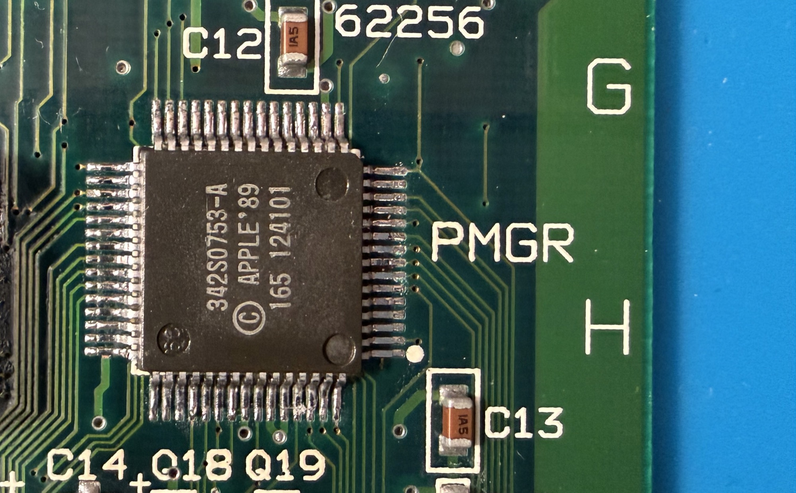
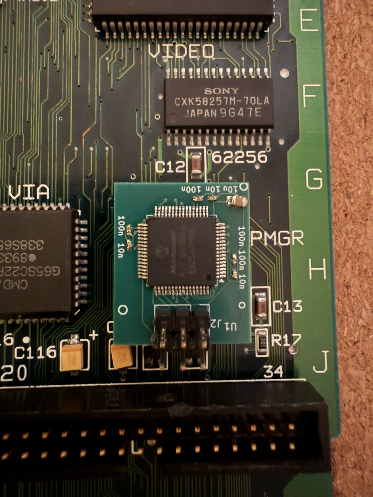
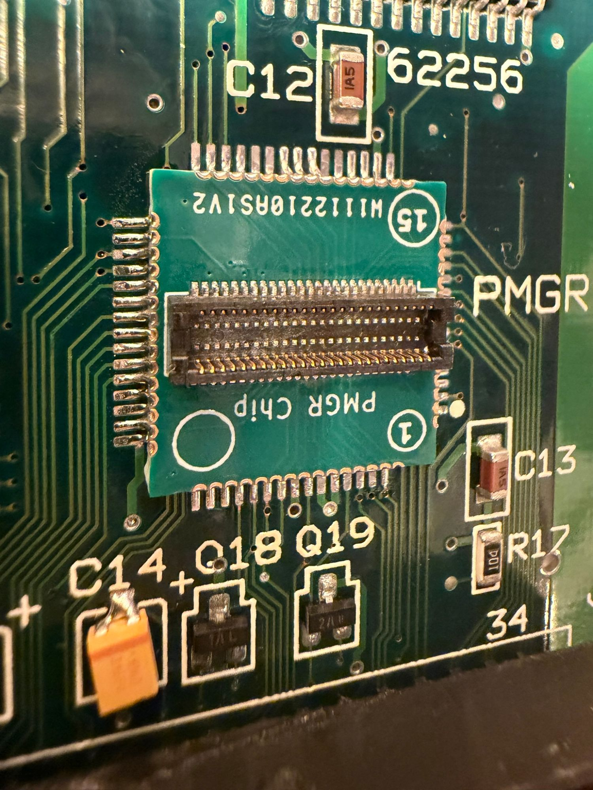
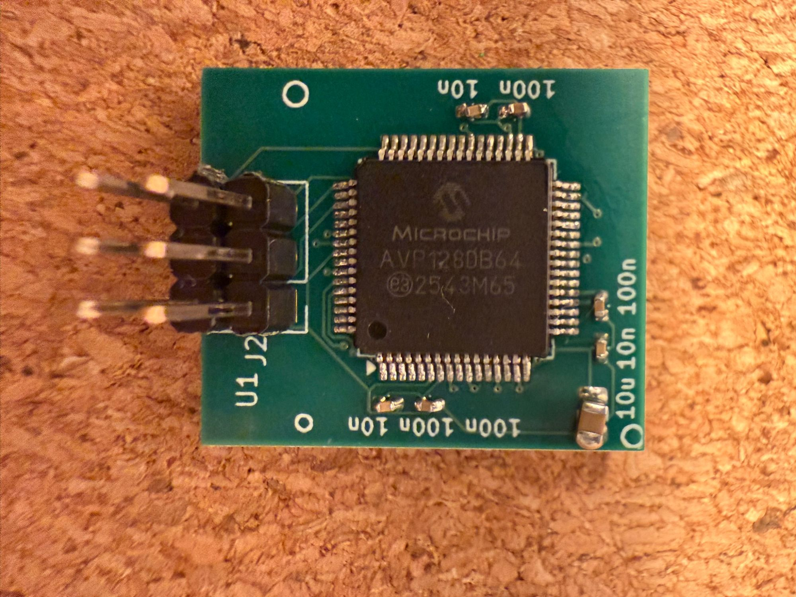
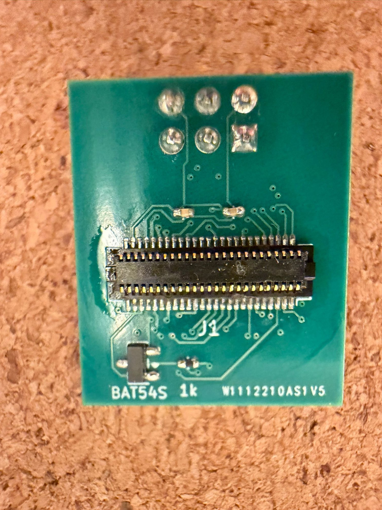
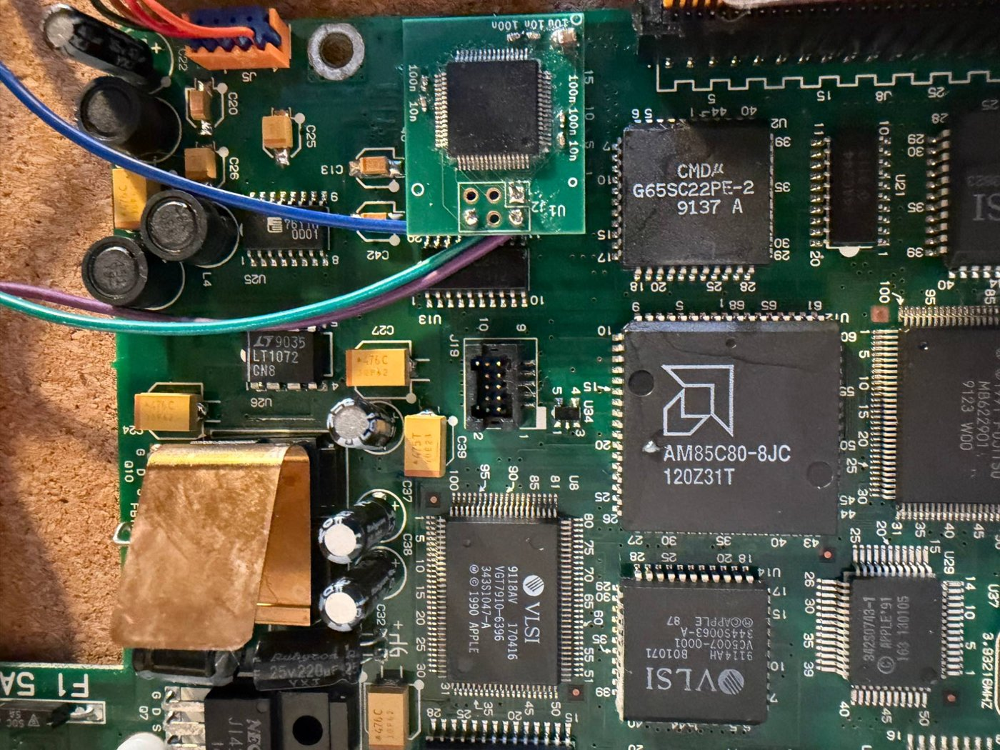
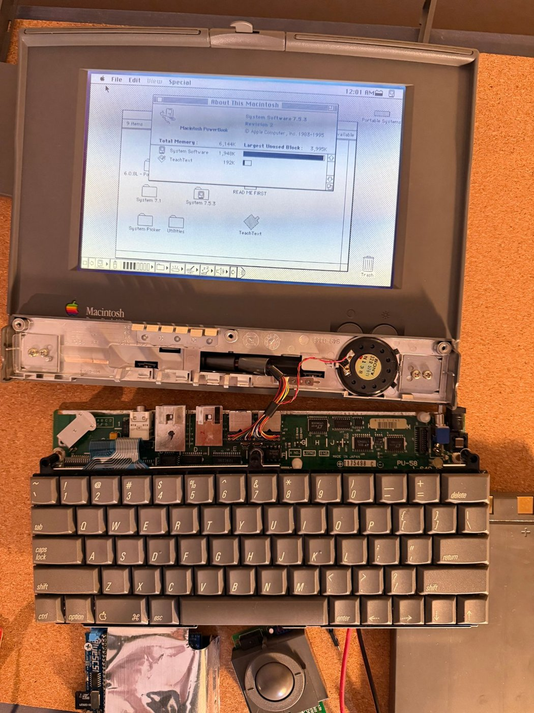
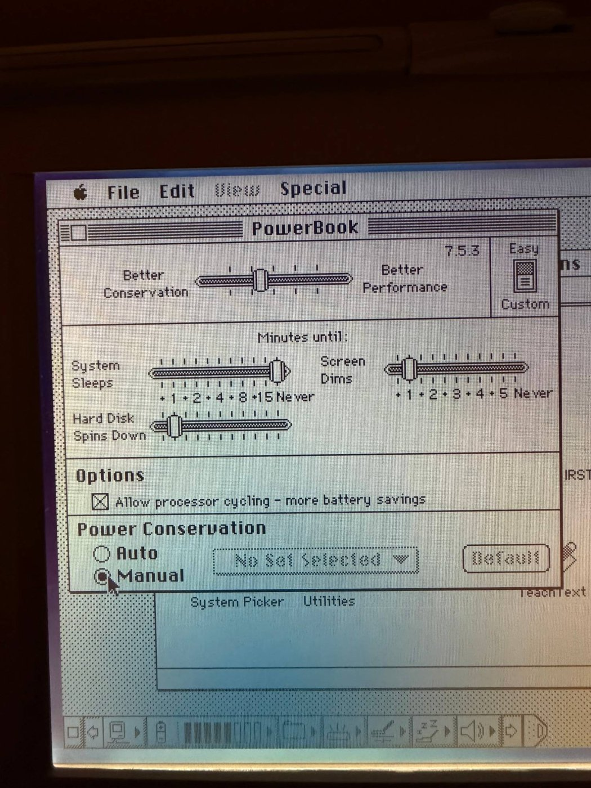
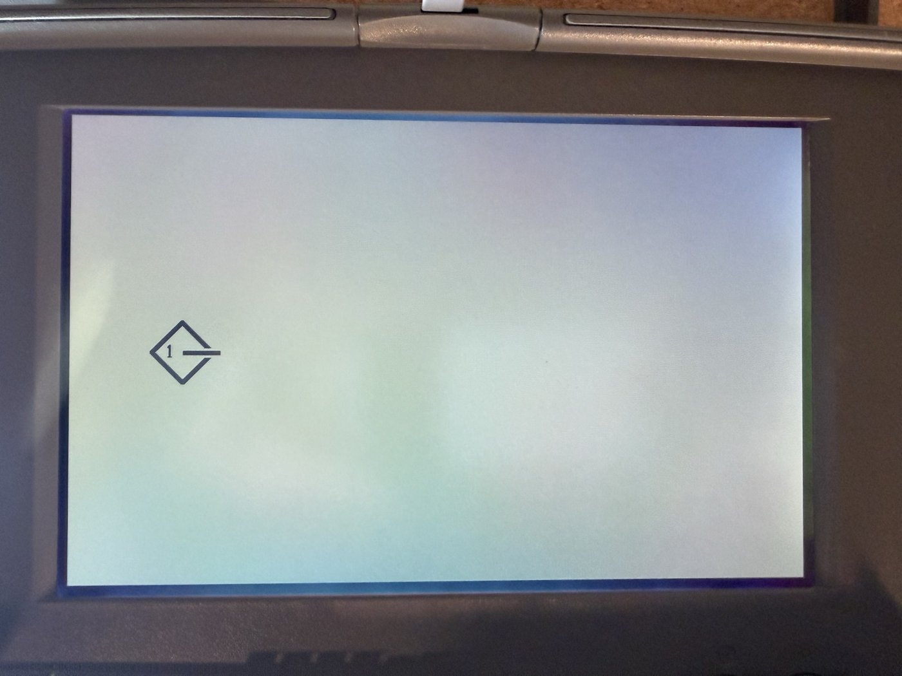

# Macintosh Portable PMGR replacement

An open replacement for the **Mitsubishi M50753 power manager (PMGR)** in the Macintosh Portable
and the **PowerBook 100**, which use the same chip. The original chip is irreplaceable when it fails; this is a small two-board stack that solders onto
its footprint and runs open firmware on a Microchip **AVR128DB64**, reproducing the original's
behaviour toward the Mac.

| | |
|---|---|
| **Interposer** | 16.3 mm square, castellated — solders onto the M50753's footprint on the logic board |
| **MCU board** | 20.0 × 23.5 mm — carries the AVR, plugs onto the interposer through a Hirose DF12 connector |
| **J21 breakout** *(optional)* | sits between the two for development, bringing every PMGR signal out to 2.54 mm Dupont headers |

## Photos

<table>
<tr>
<td width="50%"><br><b>Before:</b> the original M50753 (Apple 342S0753-A) at the PMGR position.</td>
<td width="50%"><br><b>After:</b> the replacement stack at the same position.</td>
</tr>
<tr>
<td><br>The interposer soldered to the original footprint. This first batch is labelled <code>PMGR Chip</code>; boards made from the current files say <code>J1</code>.</td>
<td><br>MCU board, top: the AVR128DB64 and the UPDI programming header <code>J2</code>.<br><br><br>Underside: the DF12 socket <code>J1</code>, and the <code>BAT54S</code> + 1 kΩ clamp on the battery-sense line.</td>
</tr>
<tr>
<td><br><b>PowerBook 100:</b> the same stack at U22, beside the VIA. The CPU board fits over it; the wires are the programming header, brought out for development.</td>
<td><br>The PowerBook 100 at the Finder under System 7.5.3, running on the replacement PMGR.<br><br><br>Its PowerBook control panel. The backlight brightness dial works through the replacement.</td>
</tr>
<tr>
<td colspan="2"><br><b>SCSI Disk Mode</b> on the replacement (0.1.16, with the pin-48 wire): HDI-30 pin 1 grounded at startup, and the PowerBook shows its disk-mode screen with SCSI ID 1.</td>
</tr>
</table>

## Status — version 0.1, prototype

**Working in a Macintosh Portable and, since 0.1.15, a PowerBook 100.**

- **Macintosh Portable M5120** (the original, non-backlit model): it boots, sleeps and wakes, shuts down
  and honours the reset switch under System 6.0.8 and 7.5.3, and a supervised fast charge terminates
  correctly. A second, unmodified Portable is kept as the reference. **The backlit Portable (M5126)
  has not been tried.**
- ⭐ **PowerBook 100** (one machine, System 7.5.3): it boots to the Finder, the **brightness dial**
  works, it sleeps and wakes, and Mac OS shows its whole low-battery sequence and then sleeps the
  machine. The same boards and the same firmware fit both machines; no PowerBook-specific build is
  needed. ⭐ Since 0.1.16, **SCSI Disk Mode works** with one extra wire on the boards (below).
  **Not yet:** charging (no battery for it yet, so it is uncalibrated and ran on a bench supply), and
  a closed case. See [`docs/VERIFIED.md`](docs/VERIFIED.md#powerbook-100).

**0.1.16 makes SCSI Disk Mode work on the PowerBook 100**, and fixes two more registers the Mac can read:
- **Disk mode:** the SCSI Disk Adapter grounds a pin on the HDI-30 port, which reaches the PMGR's
  **pin 48**. The boards don't connect pin 48 yet, so it needs **one hand-added wire** through the
  connector's spare position 50 ([`docs/BUILD.md`](docs/BUILD.md)). With it, grounding that pin at
  startup gives the PowerBook's SCSI disk-mode screen, as the original does. Without it, the machine
  simply boots normally, and the same firmware still runs a Portable.
- **The internal disk's power at startup:** the PowerBook 100 ROM checks one PMGR port bit at every
  boot and switched the internal disk's power off when it read 0, as it did on 0.1.15 and earlier.
  It now reads 1, as on the original.
- **The clock through the memory-read command** (`$25`–`$29`) came back byte-reversed, and its
  checksum read 0. Both now match the original. The normal time commands were always correct.

**0.1.15 brought the PowerBook 100 up, and fixed two things every earlier version got wrong:**
- ⛔ **The PWM output (M50753 pin 57) was never driven** on 0.1.14 and earlier, because of an
  AVR128DB silicon erratum. On the Portable that line is the **LCD contrast**, so the contrast control
  could not have worked; it went unnoticed because the development Portable's original LCD is not
  connected. On the PowerBook 100 the line is the **backlight brightness**. Now fixed: measured with
  a scope on the Portable, and seen on the PowerBook's backlight.
- **A register the PowerBook 100 ROM reads** (`$EE`) answered 0, which made the PowerBook boot
  straight into SCSI Disk Mode. It now answers as the original does, and seven more of the
  original's port and PWM registers now read back as they do on the original.
- The battery-reading self-check (`DBG2`) now uses an internal reference, so it gives the same verdict
  on both machines and is valid as soon as power is applied.

Earlier releases: **0.1.12 fixed how fast charge is handled across sleep** (on 0.1.11 and earlier,
don't let the Mac sleep during a fast charge) and added support for **replacement (recreation)
hybrids**, which cut the power at a higher battery voltage; the calibration record says which hybrid
is fitted. ⛔ **Upgrading from 0.1.11 or earlier: rebuild your `calib.args` with `--hybrid` before
flashing** — see [`docs/BUILD.md`](docs/BUILD.md) §7; the flash tool refuses the old record format.
**0.1.14 lowered the recreation-hybrid warning levels** to about 6.10 V warning / 6.02 V sleep.

It is a **prototype**. Some parts of the charging behaviour have not been characterised on
hardware yet. Read [`docs/VERIFIED.md`](docs/VERIFIED.md) for exactly what has and has not been
shown — before relying on it unattended.

## Before you start: this is fine-pitch soldering

Building and fitting this needs **experienced surface-mount work** — it is not a beginner's kit:

- a **0.5 mm-pitch TQFP-64** (the AVR) and two **50-pin, 0.5 mm-pitch** Hirose DF12 connectors;
- **0402** resistors and capacitors (about 1 × 0.5 mm), several on the board's **underside**;
- removing the original **60-lead power manager** from the Mac's logic board (U22 on a PowerBook 100), then soldering the
  interposer's **castellated edges** onto that footprint.

You'll want a hot-air station with preheat, a fine-tip iron, flux, solder wick, and magnification —
a stereo microscope makes this far easier. Having the fab assemble the MCU board removes most of the
0.5 mm work; removing the original chip and fitting the interposer still has to be done by hand.
See [`docs/BUILD.md`](docs/BUILD.md).

## ⛔ Safety — read before you start

- **The battery-sense input of an ORIGINAL M50753 is unprotected.** On a machine still carrying
  the original chip, never put more than **6.5 V** on the battery input while probing; over-driving
  that pin is a documented way to destroy the chip. (This design adds a clamp on that line.)
  The same applies to a **PowerBook 100**: its battery sense is the same circuit.
  The same applies to a **PowerBook 100**, whose battery sense is the same circuit.
- **Never take power from the floppy connector (J15)** for accessories such as an LCD controller.
  It destroyed a PMGR during development.
- **Supervise the first charge.** The charger was designed for the original Gates/EnerSys Cyclon
  cells, which accept an unlimited initial current. Many modern substitute packs are rated far lower.
- **Every flash must re-write the calibration record** (see [`docs/BUILD.md`](docs/BUILD.md)).
  Without it the firmware deliberately refuses to fast-charge.
- **After any programmer operation — flash, fuses, even just reading the device ID — unplug the
  programmer and power-cycle the machine** (supply or battery disconnected) before expecting it to
  start. Otherwise a machine that is shut down may not wake from the keyboard. While the programmer
  is connected it **back-feeds the board**, so switching off is not a power cycle.

## Repository

```
docs/BUILD.md             start here: order, assemble, program, calibrate, install
docs/PROGRAMMING.md       building the firmware and flashing the AVR, step by step
docs/VERIFIED.md          what has been shown on hardware, and what has not
docs/REFERENCE-MEASUREMENTS.md  known-good voltages and pin references to check against
docs/ASSEMBLY.md          the detailed, bench-tested assembly procedure
docs/PINOUT.md            M50753 pin -> interposer -> AVR mapping
docs/MCU-BOARD-SCHEMATIC.md
docs/BOM.md, ORDER-LIST.md
hardware/mcu-board/       MCU board rev A (built and tested): KiCad board + Gerbers
hardware/interposer-v2/   interposer rev A (built and tested): KiCad board + Gerbers
hardware/mcu-revb/        MCU board rev B: disk-mode path, edge pads, fits the Portable's closed case (not yet fabricated)
hardware/interposer-revb/ interposer rev B: disk-mode line built in (not yet fabricated)
hardware/breakout-j21/    bench tool: J21 breakout, built and used on the Portable
hardware/breakout-pb100/  bench tool: PowerBook 100 breakout, should work in both (not yet fabricated)
hardware/carrier-m50753/  bench tool: carrier for an ORIGINAL M50753 on the interposer (not yet fabricated)
firmware/                 AVR firmware, host-side unit tests, fuse policy
tools/                    flashing and calibration scripts
```

## The ROM image

The M50753 carries a small program ROM that the Mac can read back. **The default build contains a
synthetic image — no Apple code anywhere in this repository.** A byte-exact build is possible if you
supply your own dump of the original ROM; see [`firmware/README.md`](firmware/README.md). Never
commit that dump.

## Licences

- Hardware (`hardware/`): **CERN Open Hardware Licence v2 — Strongly Reciprocal** (`LICENSE`)
- Firmware and tools (`firmware/`, `tools/`): **MIT** (`LICENSE-MIT`)

This repository is the clean release. The full development record — every measurement, the
mistakes and their corrections — is kept separately. Questions and results from other machines are
welcome as issues; readings from original, un-modified Portables are especially useful.
