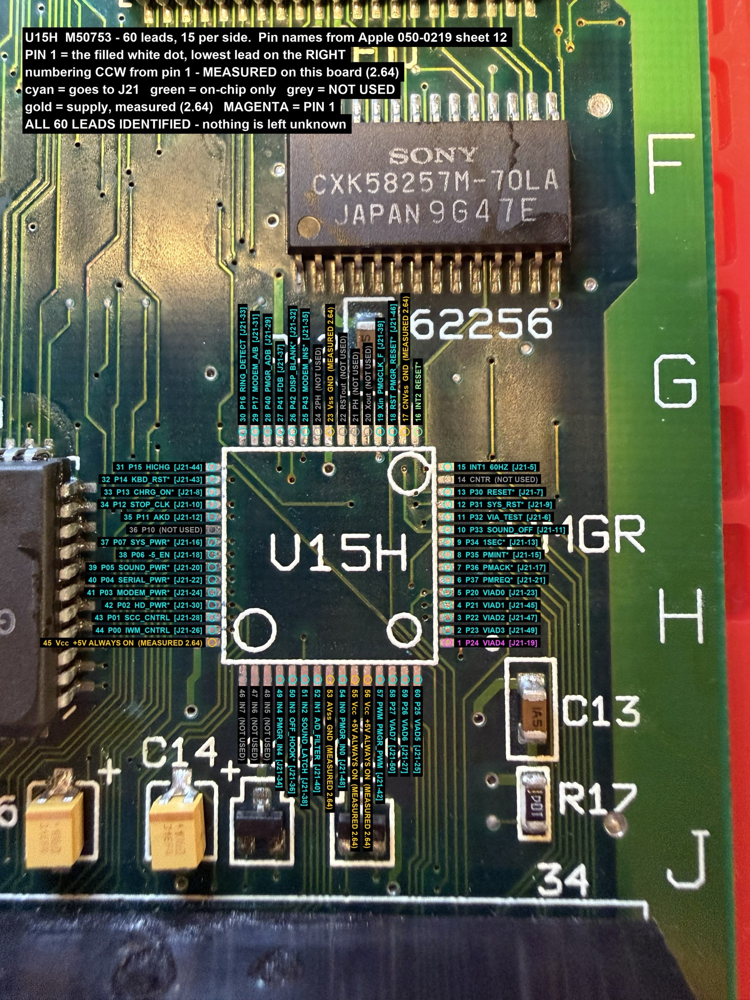
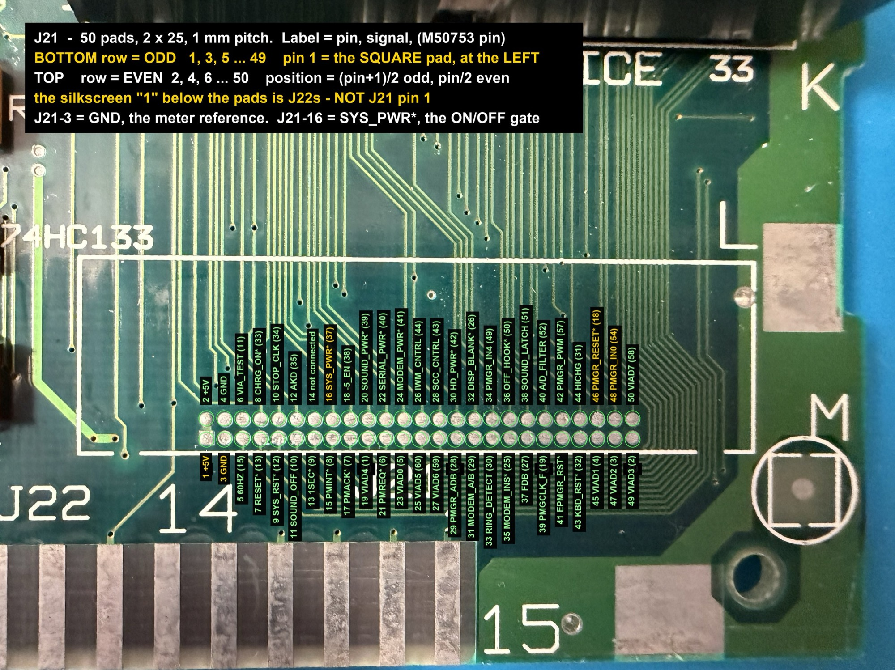
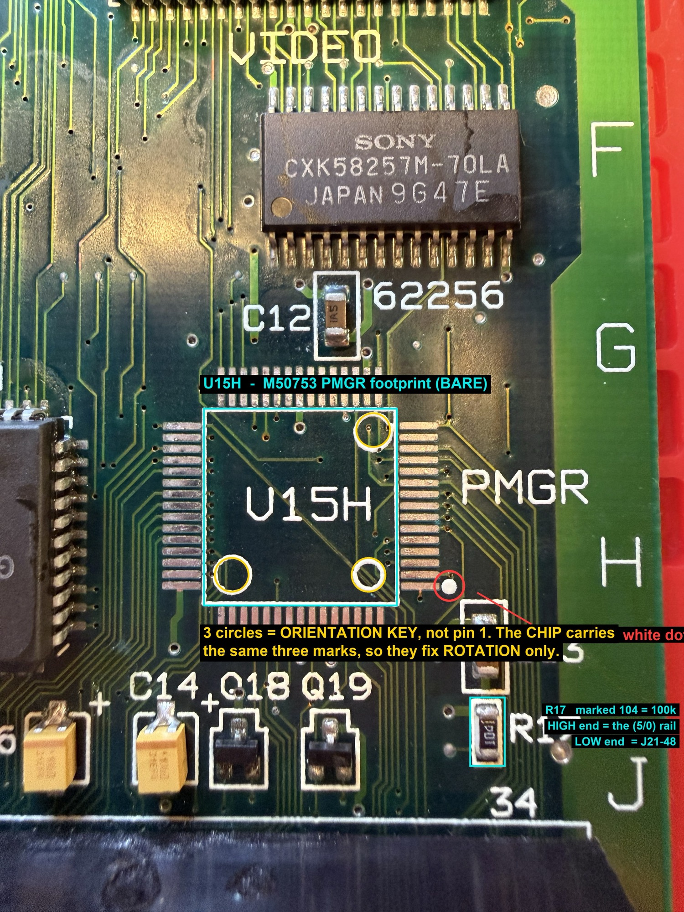
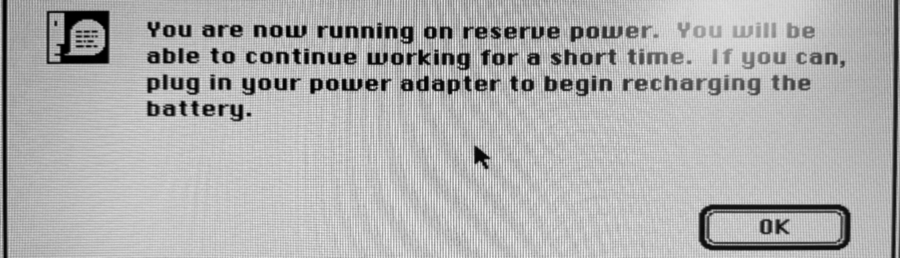
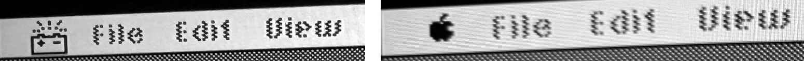
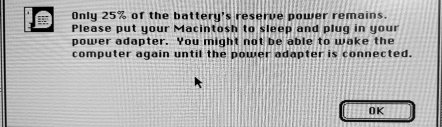
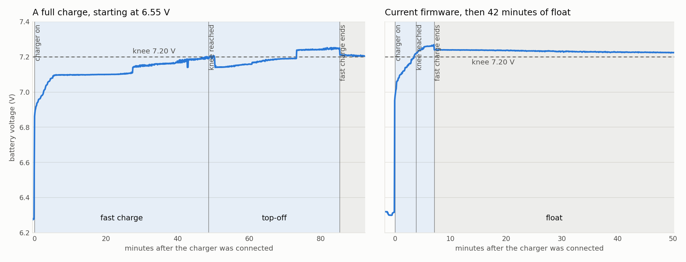

# Reference measurements

Known-good values to check your machine against. Everything here was **measured on our own two
Portables**: one fitted with this replacement, and one **unmodified** (original hybrid, original
M50753), which is the reference for anything the hybrid produces.

⚠️ One unmodified machine is a small sample. Expect your readings to differ by tens of millivolts;
a difference of tenths of a volt is worth looking into.

⛔ **On a machine with the ORIGINAL M50753, keep the battery input at or below 6.5 V while probing.**
Its battery-sense pin is unprotected.

## Pin references

**M50753 (U15H) — all 60 leads.** Pin 1 is the filled white dot, lowest lead on the right;
numbering runs counter-clockwise, confirmed by continuity on the board. Each lead is labelled with
its signal and the J21 pin it reaches.



**J21 — the 50-pad diagnostic connector** (2 × 25, 1 mm pitch). Bottom row odd, top row even;
**pin 1 is the square pad at the left.** ⚠️ The silkscreen "1" below the pads belongs to J22, not
J21. Each pad shows its signal and the M50753 pin it comes from. The J21 breakout board brings all
of these out to 2.54 mm headers with the same numbers.



**The bare footprint, for fitting the interposer.** The three circles are an **orientation key, not
pin 1** — the chip carries the same three marks, so they fix rotation only. Pin 1 is the white dot.



**AVR128DB64 (U1 on the MCU board)** — every signal pin, with the M50753 pin and J21 pin it
stands in for. Generated from the MCU board file and checked against the firmware's pin header.

| AVR pin | port | signal | M50753 pin | J21 pin |
|---:|:--|:--|---:|---:|
| 1 | `PA3` | VIAD3 | 2 | 49 |
| 2 | `PA4` | VIAD4 | 1 | 19 |
| 3 | `PA5` | VIAD5 | 60 | 25 |
| 4 | `PA6` | VIAD6 | 59 | 27 |
| 5 | `PA7` | VIAD7 | 58 | 50 |
| 8 | `PB0` | PMREQ* | 6 | 21 |
| 9 | `PB1` | PMACK* | 7 | 17 |
| 10 | `PB2` | PMINT* | 8 | 15 |
| 11 | `PB3` | SYS_RST* | 12 | 9 |
| 12 | `PB4` | RESET* | 13 | 7 |
| 13 | `PB5` | PMGR_RESET* | 18 | 46 |
| 14 | `PB6` | VIA_TEST | 11 | 6 |
| 15 | `PB7` | 1SEC* | 9 | 13 |
| 16 | `PC0` | SOUND_LATCH | 51 | 38 |
| 17 | `PC1` | OFF_HOOK* | 50 | 36 |
| 18 | `PC2` | 60HZ | 15 | 5 |
| 22 | `PC4` | PMGCLK_F | 19 | 39 |
| 26 | `PD0` | A/D_FILTER | 52 | 40 |
| 27 | `PD1` | PMGR_ADB | 28 | 29 |
| 28 | `PD2` | FDB | 27 | 37 |
| 29 | `PD3` | DISP_BLANK* | 26 | 32 |
| 30 | `PD4` | MODEM_INS* | 25 | 35 |
| 31 | `PD5` | SOUND_OFF | 10 | 11 |
| 32 | `PD6` | PMGR_PWM | 57 | 42 |
| 33 | `PD7` | PMGR_IN0 | 54 | 48 |
| 36 | `PE0` | AKD | 35 | 12 |
| 37 | `PE1` | STOP_CLK | 34 | 10 |
| 38 | `PE2` | CHRG_ON* | 33 | 8 |
| 39 | `PE3` | KBD_RST* | 32 | 43 |
| 40 | `PE4` | HICHG | 31 | 44 |
| 41 | `PE5` | RING_DETECT | 30 | 33 |
| 42 | `PE6` | MODEM_A/B | 29 | 31 |
| 47 | `PF3` | debug pad — ADC scale check passed | — | — |
| 48 | `PF4` | debug pad — ADC timeout (latched) | — | — |
| 49 | `PF5` | debug pad — RTC/PIT sync timeout | — | — |
| 52 | `PG0` | SYS_PWR* | 37 | 16 |
| 53 | `PG1` | -5_EN | 38 | 18 |
| 54 | `PG2` | SOUND_PWR* | 39 | 20 |
| 55 | `PG3` | SERIAL_PWR* | 40 | 22 |
| 58 | `PG4` | MODEM_PWR* | 41 | 24 |
| 59 | `PG5` | HD_PWR* | 42 | 30 |
| 60 | `PG6` | SCC_CNTRL | 43 | 28 |
| 61 | `PG7` | IWM_CNTRL | 44 | 26 |
| 62 | `PA0` | VIAD0 | 5 | 23 |
| 63 | `PA1` | VIAD1 | 4 | 45 |
| 64 | `PA2` | VIAD2 | 3 | 47 |

- **Not wired to the AVR:** J21-34 `PMGR_IN4` (M50753 pin 49 — an input the original firmware does
  not read) and J21-41 `EPMGR_RST*` (belongs to the J21 connector, not to the chip).
- **Power and programming pins** (VDD, AVDD, VDDIO2, ground, UPDI, RESET) are in
  [`MCU-BOARD-SCHEMATIC.md`](MCU-BOARD-SCHEMATIC.md).
- All eight VIA data bits sit on `PORTA`, so a bus read is a single instruction — the handshake
  timing depends on it.

The full pin-by-pin mapping, through the interposer to the AVR, is in [`PINOUT.md`](PINOUT.md).

### Footprint checks — power OFF, before fitting anything
```
  M50753 pins 45, 55, 56  ->  J21-1   +5 V always-on      ~0.1 Ω
  M50753 pins 17, 23, 53  ->  J21-3   ground              ~0.0-0.1 Ω
  M50753 pin 54           ->  R17, the end nearer J21-48  ~0.2 Ω   (confirms the pin numbering)
```

## Healthy voltages — unmodified machine

Battery input set to **6.41 V at the pack connection** (by DMM), machine **off and not booted**,
charger and programmer disconnected, **ground at battery negative**.

```
  hybrid pin 16, 17           battery input path      6.41 V   (= the input)
  hybrid pin 19               charger status          5.15 V
  hybrid pin 22               Q1 control              6.33 V   (Q1 gate 6.32 V -> Q1 OFF)
  hybrid pin 37               -5 V enable             ~4 mV
  hybrid pin 39               HICHG                   ~3 mV
  J21-1                       +5 V always-on rail     5.2 V    (measured with 5.70 V in)
  J21-40                      battery sense (A/D)     ~2.61 V  (from the line below)
```

⚠️ **Hybrid pin numbers are their own numbering** — not J21 numbers and not M50753 pins. Match
points by signal name. For where the hybrid's pins are, and for readings from a **replacement
hybrid**, see the documentation from **Androda**, who makes one.

**Q1** is the IRF9Z30 P-channel MOSFET beside the charger jack: the **fast-charge bypass** across
R10 (100 Ω). On, it gives the low-resistance charge path; off, charging continues through R10.
Its gate is driven by hybrid pin 22.

## Battery sense — what the PMGR sees

On the unmodified machine, the voltage at the PMGR's battery-sense input follows the pack:

```
  A/D_FILTER = (V_pack - 5.1249) x 2.0324        11 pairs, scatter 8 mV

  pack 5.90 V  ->  ~1.58 V      pack 6.41 V  ->  ~2.61 V      pack 7.20 V  ->  ~4.22 V
```

Hybrids differ: another machine read **tenths of a volt** lower at the same pack voltage. That
spread is why each board gets its own calibration record ([`BUILD.md`](BUILD.md) §7).

**Apple's design** (*Apple Guide to the Macintosh Family Hardware*, 2nd ed., pp. 266–267): the battery-sense amplifier maps **5.12–7.68 V onto the
0–5 V A/D range** — nominally 100 A/D steps per volt, starting at 5.12 V. The measured line above has the
same 5.12 V offset and a gain about 4 % higher.

## The firmware's battery levels

The same levels as the original, applied to the calibrated reading:

```
  level         ROM value (pmuv1.bin)                  calibrated   what it does
  knee          208  literal compare, cmp #720-512     7.20 V       below it, fast charge runs; crossing it starts the top-off timer
  LOW           78   lowBatteryLevel  = 590-512        5.90 V       the low-battery condition the Mac warns about
  STAY_ASLEEP   70   computed: (78>>1) + (62>>1)       5.82 V       below it, the machine can no longer be woken
  DEAD          62   deadBatteryLevel = 574-512        5.74 V       the PMGR puts the machine to sleep itself
```

The **values** are Apple's, read from the original M50753 firmware; the ROM stores no voltages.
The **voltages** are our calibration of those values on an unmodified Portable (original PMGR
and original hybrid). `HICHGLevel` (200) is a separate stored setting, not the knee.

The calibration agrees with Apple's own figures (*Apple Guide to the Macintosh Family Hardware*, 2nd ed., pp. 266–267): the Power Manager puts the
machine to sleep below **5.74 V**, and fast charge runs until **7.2 V**, then for the same time
again. Because the nominal A/D scale starts at 5.12 V with 100 steps per volt, Apple's constants read as volts × 100 —
`574-512` is 5.74 V, `590-512` 5.90 V, `720-512` 7.20 V.

## Cut-off

The unmodified machine's hybrid **cuts off between 5.61 and 5.70 V** at the battery input, and
comes back on at the next step up — essentially no hysteresis. Apple specifies **5.65 V**, with
power restored above 5.65 V (*Apple Guide to the Macintosh Family Hardware*, 2nd ed., pp. 266–267). If your machine dies well above
this, suspect the hybrid or the battery wiring before the PMGR.

## Low battery — what you should see

As the battery runs down, Mac OS shows Apple's own three warnings, then puts itself to sleep. Plug
in the power adapter (or fit a charged battery) and press a key: the machine **wakes where it left
off**, with nothing lost. This was checked on the development machine with the board set for its
hybrid (`--hybrid`, [`BUILD.md`](BUILD.md) §7).

**1. Reserve power** — the battery bars are down to about one of eight.



**2. A quarter of the reserve left.** In the menu bar, a battery icon flashes in place of the
Apple menu (left: the battery icon; right: the Apple logo it alternates with).





**3. No reserve left** — a ten-second countdown, then Mac OS puts the machine to sleep itself.


Measured at the battery input on the development machine (recreation hybrid, set as
`recreation`): warning 1 at about 6.19 V, warning 2 at about 6.12 V, warning 3 and sleep at about
6.07 V — all above that hybrid's 5.92 V cut-off. With an original hybrid, set as `original`, the same
sequence follows Apple's own levels (warning at 5.90 V, sleep by 5.74 V).

On a **real pack** (rather than a bench supply) the sequence is the same, but the warnings come
earlier in the pack's life: its voltage is nearly flat around 6.2 V under load, so the first warning
appeared soon after starting from a part-charged pack, and Mac OS put the machine to sleep about an
hour later. The second and third warnings are timed by Mac OS itself, not set by a level. With the
charger connected, a keypress resumes the machine.

⚠️ **If the machine just switches off with no warning**, the board is probably set for the wrong
hybrid: a recreation hybrid set as `original` cuts the power before the warnings can appear.

## Charging — measured on the development machine

<picture>
  <source media="(prefers-color-scheme: dark)" srcset="../images/charge-curve-dark.png">
  
</picture>

**Left:** a full charge from 6.55 V — fast charge climbs to the knee, the top-off timer then runs
for a further ~37 minutes, and fast charge ends. **Right:** the current firmware, starting close to
the knee, then 42 minutes of float. The left run used the firmware before the battery-reading
interlock was added; the charging logic is otherwise the same. Phases are read from the PMGR's own
flags; the knee marker is where its reported level reached 208 (7.20 V).

> ⭐ **The float level here is the replacement hybrid's.** That hybrid regulates the float itself,
> holding the fast-charge transistor Q1 partly on, and it settles at about **7.21 V** at the pack
> (about 0.08–0.10 A). Apple specifies **6.94–7.16 V at 20 °C**, falling about 7.5 mV per °C
> (*Apple Guide to the Macintosh Family Hardware*, 2nd ed., pp. 266–267); an original hybrid floated
> about **6.98 V** on the same pack. This is why the drop when fast charge ends is small.
>
> The **step changes** in the left panel (around 27, 50 and 73 minutes) are probably the Mac's own
> power use changing while it ran, since the charger supplies both the machine and the pack. That
> has not been checked.

A 3-cell Cyclon pack, the machine's own charger, two supervised charges:

```
  fast charge crosses the knee at      7.198 V / 7.220 V
  fast charge terminates at            7.211 V / 7.240 V
  highest pack voltage seen            7.252 V / 7.269 V
  float, 42 min after termination      ~7.23 V  (one observation, voltage only)
```

A DMM at the pack agreed with the logged readings to about 15 mV.

### Explained since earlier versions

Earlier versions listed the development machine's high float and its Q1 held on as unexplained,
possibly a logic-board fault. Both turned out to be the replacement hybrid's design:

- **Q1 with no charger:** the hybrid's float comparator is powered only from the charger, so with
  no charger Q1's gate is left low and Q1 reads as on. With no charger there is nothing for it to
  pass, so this is harmless.
- **Float:** with the charger in, that comparator holds Q1 partly on to regulate the float at about
  7.21 V, instead of switching to the slow path through R10 as an original hybrid does.

**Charge current** is now measured (clamp meter on the battery lead, one pack): about 0.30 A at the
start of fast charge with the Mac running, tapering toward the knee; about 0.73 A with the Mac
asleep; 0.08–0.10 A once floating.

If you have a Portable with an original hybrid, a logged charge with the pack voltage at
termination would still help.

## Board checks

```
  AVR device ID (pymcuprog ping)       1E970B
  standby current, Mac switched off    ~10 mA  (13 mA from cold)
  DBG2 high, DBG1 low                  healthy ADC   (see ../firmware/README.md)
```
