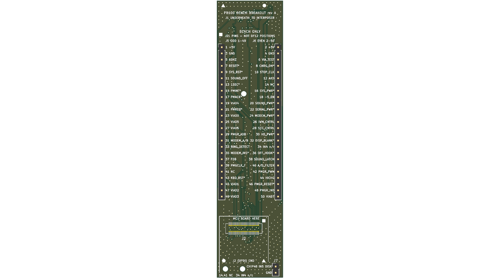

# PowerBook 100 breakout — bench tool

> 🧪 **Bench tool, not part of the replacement.** It sits between the interposer and the MCU board with
> the case open, brings every PMGR signal out for a logic analyser, and comes out before the machine is
> closed. **Designed and checked, not yet fabricated:** it should work in both machines; the
> [J21 breakout](../breakout-j21/README.md) is the one that has been built and used (on the Portable).

The [J21 breakout](../breakout-j21/README.md) stacks the MCU board directly above the interposer, about
12 mm tall, which the PowerBook 100's CPU card (about 10.4 mm above U22) does not allow. This one is a long
**cantilever**: the base end plugs onto the interposer under the CPU card, and the MCU board plugs in
at the far end, out in open bench space.

```
  base end (under the CPU card)                                       tip (open bench space)
  J1 DF12 socket underneath → interposer │ J5/J6 2.54 mm headers, J21 numbering │ MCU board on J2 │ J7
```

| | |
|---|---|
| Size | 27 × 113 mm (the tip is 105 mm past the DF12 centre) |
| Fab | 4 layer · 1.6 mm · ENIG (two 0.5 mm DF12 connectors) · vias 0.6 / 0.3 mm, tented |
| Parts | `J1` DF12 socket (`DS`, **bottom**, mates the interposer) · `J2` DF12 header (`DP`, top, **turned 180°**: the MCU board plugs in turned round, its `J2` end toward the tip) · `J5`/`J6` 1×25 2.54 mm (the Portable's J21 pin numbers, odd / even) · `J7` 1×2 2.54 mm: `DISK_MODE_N` (DF12 position 50, M50753 pin 48) and GND |
| Fabrication files | `gerbers/` (with `pmgr_breakout_pb100_gerbers.zip`) |
| Design | `pmgr_breakout_pb100.kicad_pcb` (KiCad 10) — see `BOM.md` |

Notes:
- With an MCU board on the tip it is a long lever: support it. `H1` (mid-span) takes a foot or standoff.
  The [rev B MCU board](../mcu-revb/README.md) covers the tip holes `H2`/`H3`, so use `H1`.
- Mate each DF12 pair by hand before soldering: every stack height shares the footprint, and these must be 3.0 mm.
- Cosmetic: a few vias sit under labels, so the drill clips some letters.


