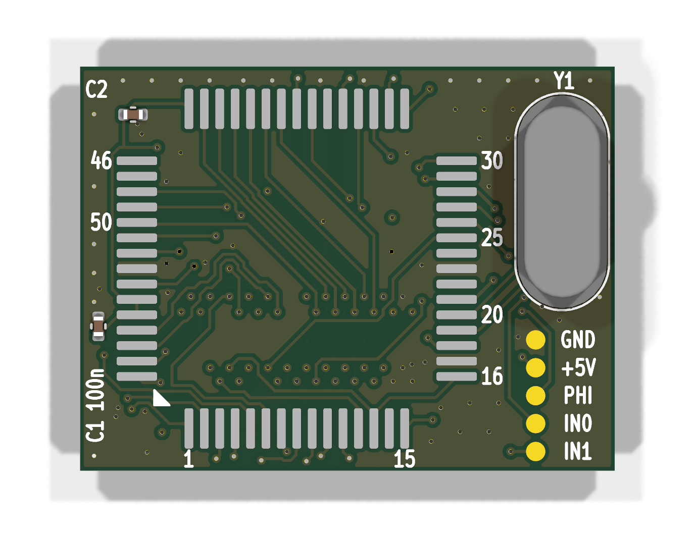
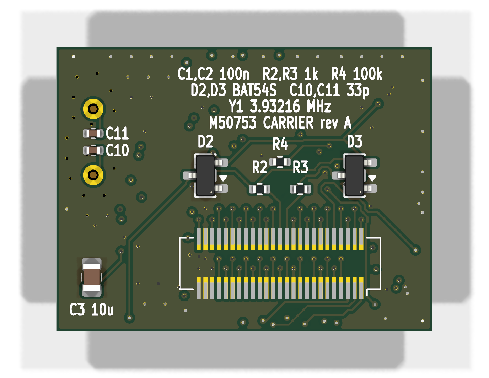

# Original-chip carrier — bench tool

> 🧪 **Bench tool, not part of the replacement.** **Designed and checked, not yet fabricated;** it should
> work in both machines.

Holds an **original M50753** power manager on a small board that plugs onto the interposer's DF12 header
**in place of the MCU board**. An original chip can then move between machines without reflow, and be
compared with the replacement on the same machine. It needs an interposer (rev B for PowerBook 100 SCSI
Disk Mode, as with the MCU board).

| | |
|---|---|
| Size | 27.75 × 21 mm: the chip, plus a tab on one side for the crystal and test pads. Shaped and positioned to fit under the Portable's case and beside the PowerBook 100's CPU card (checked with a 3D-printed model at the real heights) |
| Fab | 4 layer · 1.6 mm · ENIG · parts on both sides · vias 0.45 / 0.20 mm, tented |
| Fabrication files | `gerbers/`, `pmgr_carrier_gerbers.zip` |
| Design | `pmgr_carrier.kicad_pcb` (KiCad 10) — see `BOM.md` |

## What the carrier adds around the chip

| chip pin(s) | on the carrier | why |
|---|---|---|
| 19 Xin / 20 Xout | **its own 3.93216 MHz crystal** + two 33 pF C0G load caps | the clock pins are not carried through the interposer. Crystal: HC-49/US **short** can (3.5 mm), e.g. JYJE S1C39321XWJAC; the tall HC-49/U can does not fit |
| 52 IN1 / 54 IN0 | 1 kΩ + BAT54S clamps to the rails | the analogue inputs of an original chip are unprotected |
| 49 IN4 | 100 kΩ to ground | not carried by the interposer |
| 16 INT2 | tied to RESET* (pin 13), as on the logic boards | |
| 23 VSS | ground | |
| 21 φ | test pad **PHI** | should read **983.04 kHz** (the crystal ÷ 4) once the chip runs |
| 14, 22, 24, 36, 46, 47 | open, as on the logic boards | ⛔ pin 36 (P10) is read by the PowerBook 100's ROM: never tie it |

Test pads on the tab: GND, +5V, PHI, IN0, IN1. Every other PMGR signal is on the breakouts' headers.

⛔ **An original M50753's battery-sense input is unprotected: never put more than 6.5 V on the battery
input** while it is fitted (see the main README's safety section).

Assembly by hand: the bottom side first (DF12 socket, clamps, resistors, C3, C10/C11), then C1/C2 and the
chip on top (drag-solder the 0.8 mm leads), then the crystal last, its leads trimmed flush underneath.

| front | back (seen from the back) |
|---|---|
|  |  |
