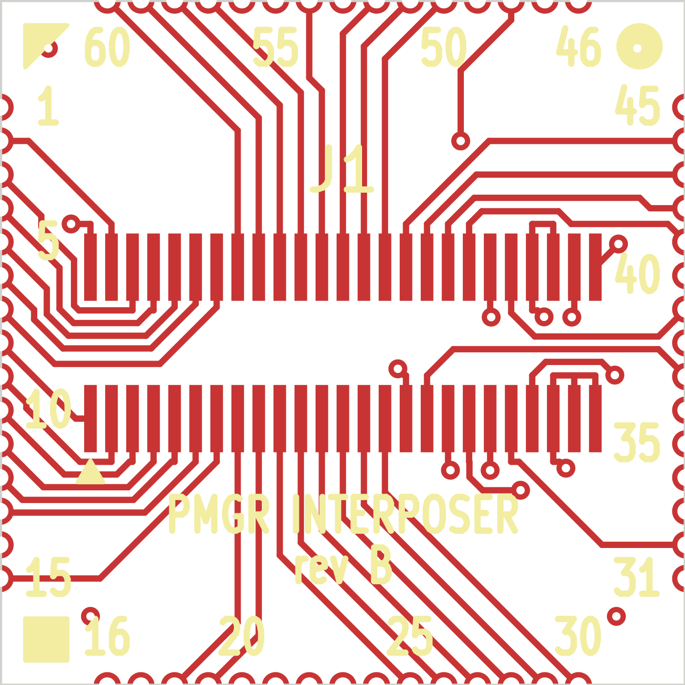

# Interposer — rev B

The same interposer as [rev A](../interposer-v2/README.md), with the **SCSI Disk Mode line built in**.
Use it with the [rev B MCU board](../mcu-revb/README.md) and a PowerBook 100 enters disk mode with no
hand-added wire.

> ⚠️ **Status: designed and checked, not yet fabricated.** Rev A is the version that has been built
> and tested. Rev B changes only what is listed below; its castellations (60 × 0.40 mm at 0.80 mm
> pitch, 0.65 mm pads) are identical to rev A's.

## What rev B fixes

| | rev A | rev B |
|---|---|---|
| **SCSI Disk Mode** (PowerBook 100) | M50753 pin 48 not connected: needs the hand-added wire in [`BUILD.md`](../../docs/BUILD.md) | **castellation 48 → DF12 position 50**, routed on the board |
| Castellation numbers on the silkscreen | none | every 5 on all four sides (1 5 10 15 · 16 20 … 60), as on the PowerBook 100's U22 |
| +5 V trace near the top edge (castellations 55–56) | runs along the edge (passes KiCad 9, flagged by KiCad 10) | moved inward |

Nothing else changes: same size, same DF12 header (`J1`), same pin mapping
([`PINOUT.md`](../../docs/PINOUT.md)) on positions 1–49.

## Which interposer should I use?

| | Portable | PowerBook 100 |
|---|---|---|
| **rev B** interposer + **rev B** MCU board | ✅ (position 50 has no net on the Portable's board, so the AVR reads "not disk mode") | ✅ disk mode, **no wire** |
| rev B interposer + rev A MCU board | ⛔ the rev A MCU board does not fit the Portable's closed case | ✅ runs; no disk mode (rev A MCU board has no path from position 50 to the AVR) |
| rev A interposer + rev B MCU board | ✅ | ✅ runs; disk mode only with the interposer's half of the wire (castellation 48 → position 50) |

**New build:** order rev B of both boards. **Already have rev A interposers:** they work in both machines
with a rev B MCU board; add the interposer's half of the wire on one going into a PowerBook 100 if you want
disk mode.

| | |
|---|---|
| Size | 16.3 × 16.3 mm |
| Fab | 4 layer · 1.6 mm · **ENIG (required)** · castellated plating on all 60 half-holes · tent all vias |
| Fabrication files | `gerbers/`, `pmgr_interposer_revb_gerbers.zip` |
| Design | `pmgr_interposer_revb.kicad_pcb` (KiCad 10) |

The Gerbers are checked against `pmgr_interposer_revb.kicad_pcb` on every layer each time this
repository is generated.

⚠️ **Fab note:** the 0.40 mm castellated holes and 0.40 mm spacing sit at a typical fab's stated
minimum; expect an engineering query. Rev A was made at exactly this geometry.

