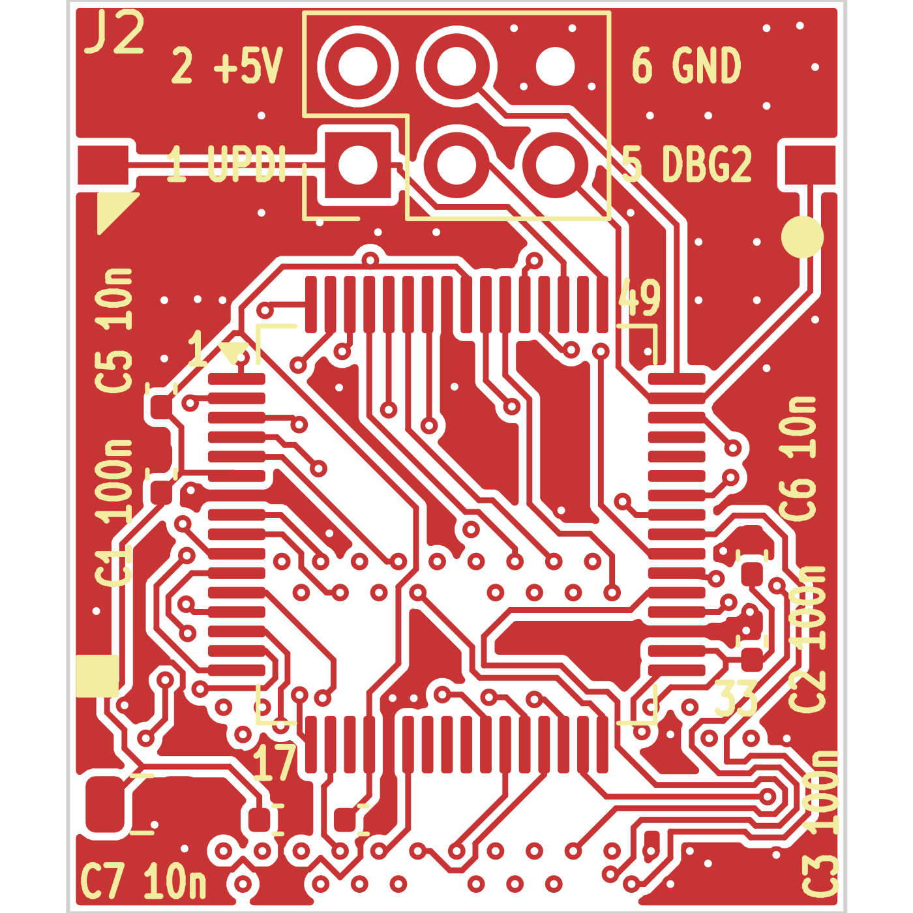
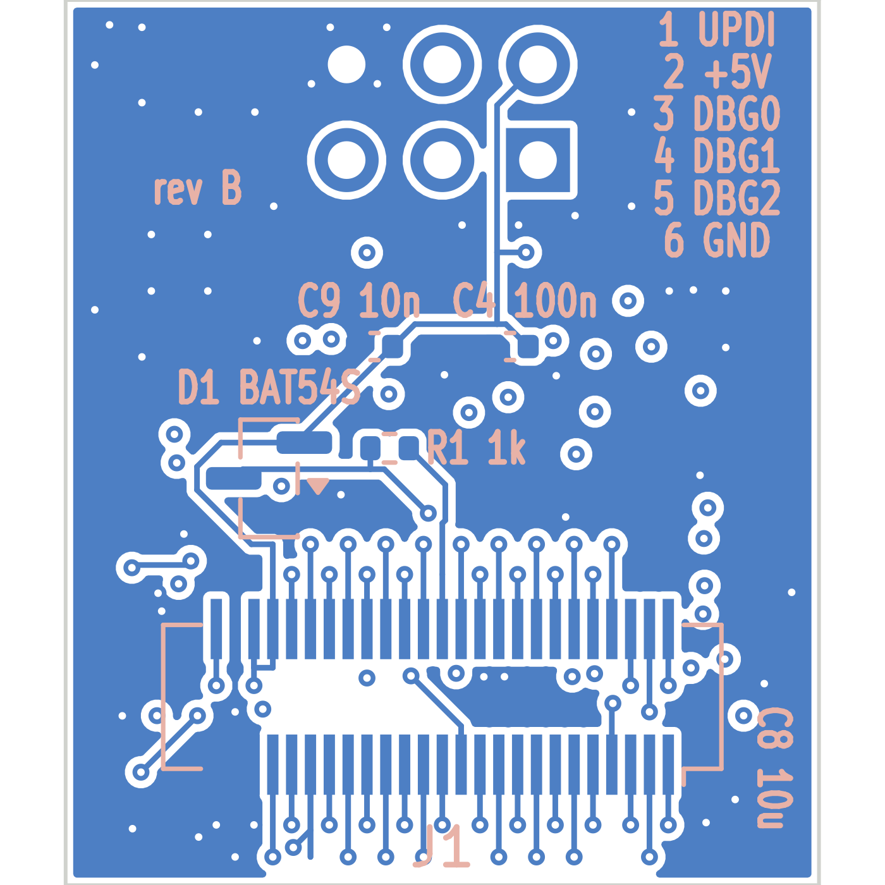

# MCU board — rev B

The same circuit as the [rev A MCU board](../mcu-board/README.md) (AVR128DB64, decoupling, the
battery-sense clamp, DF12 socket `J1`, UPDI header `J2`), with three changes: the **SCSI Disk Mode
path**, **edge pads** for programming and debugging inside the machine, and the whole board moved
**5 mm** so the **Portable's case closes** over it.

> ⚠️ **Status: designed and checked, not yet fabricated.** Rev A is the version that has been built
> and tested. Its fit was checked with a 3D-printed model of the outline at the real heights, which
> fits under both machines' cases.

## What rev B fixes

| | rev A | rev B |
|---|---|---|
| **SCSI Disk Mode** (PowerBook 100) | DF12 position 50 not connected: needs the hand-added wire in [`BUILD.md`](../../docs/BUILD.md) | **DF12 position 50 → AVR pin 46 (PF2)**, routed on the board. With the [rev B interposer](../interposer-revb/README.md): disk mode with no wire |
| **Portable, case closed** | **does not fit**: the case catches the board's edge opposite `J2` and tilts it (fine in the PowerBook 100) | **fits**: the board sits **5 mm toward the `J2` end**; the DF12 socket stays where the interposer's header is, so it still mates exactly |
| Programming / debug inside the machine | only through `J2` | bare **edge pads**: `UPDI`, `GND`, `DBG2`, each in line with the `J2` pin of the same signal. No +5 V pad, so a harness cannot back-feed the Mac |
| Labels | partial | every part numbered **with its value** (`C1 100n` …); `J2` pin names; AVR pin numbers 1/17/33/49 |

Firmware: unchanged. 0.1.16 already reads PF2 for disk mode (with a pull-up, so an unconnected
position 50 reads "not disk mode").

## Which MCU board should I use?

| | Portable | PowerBook 100 |
|---|---|---|
| **rev B** MCU board + **rev B** interposer | ✅ | ✅ disk mode, **no wire** |
| rev B MCU board + rev A interposer | ✅ | ✅ runs; no disk mode unless the interposer gets its half of the wire (castellation 48 → position 50) |
| rev A MCU board (+ either interposer) | ⛔ **case does not close** (works on the bench, case open) | ✅ runs; disk mode only with the hand-added wire |

| | |
|---|---|
| Size | 20.0 × 23.5 mm, as rev A (the outline is moved 5 mm relative to the DF12 socket) |
| Fab | 4 layer · 1.6 mm · ENIG · parts on both sides · vias 0.45 / 0.20 mm, tented |
| Fabrication files | `gerbers/`, `pmgr_mcu_revb_gerbers.zip` |
| Design | `pmgr_mcu_revb.kicad_pcb` (KiCad 10) |

The Gerbers are checked against `pmgr_mcu_revb.kicad_pcb` on every layer each time this repository
is generated. Assembly is as rev A ([`ASSEMBLY.md`](../../docs/ASSEMBLY.md), Step 1); the parts list
is the same.

⚠️ For a PowerBook 100, `J2` must not be a vertical header (9–10 mm of clearance). Leave it off and
use the edge pads, or fit it only on the bench.

| front | back (seen from the back) |
|---|---|
|  |  |
